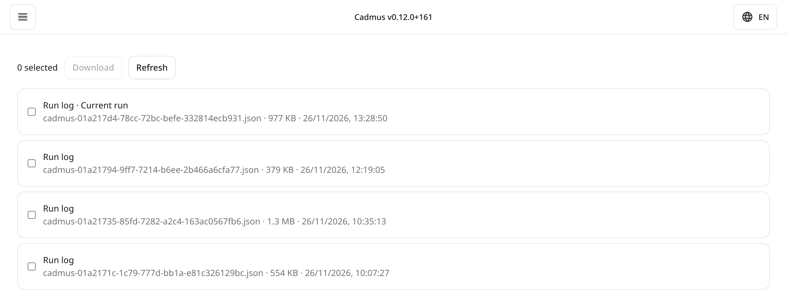
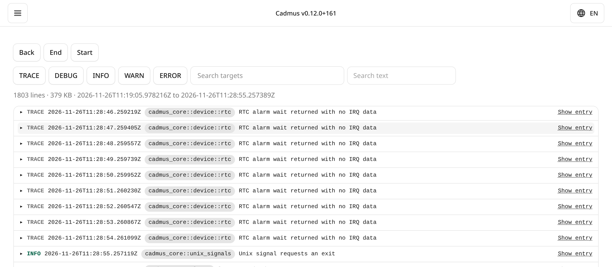
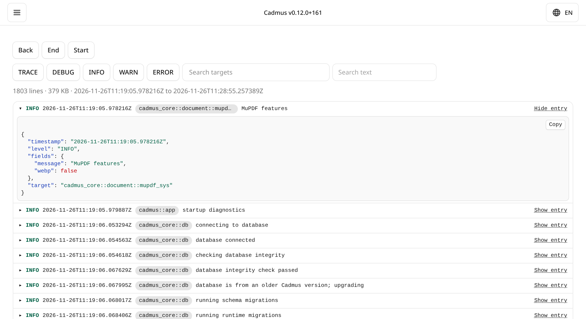
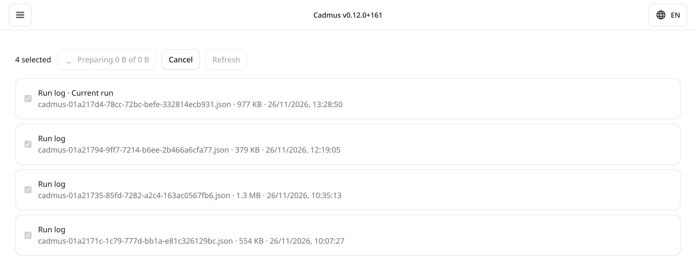

# Companion

Companion lets you manage Cadmus from a browser on another device.

Open the top menu and tap **Companion**. Cadmus opens the Companion view. It
shows a QR Code, the web address of the Companion page, and a 6-digit code.
Scan the QR Code with your device to open the page.

The Companion view shows the web address twice: once by name and once by
number. If the name does not work on your network, type the number address into
your device's browser instead.

The device has to join the same Wi-Fi network as the Kobo.

Companion needs Wi-Fi set to Auto or Always On. With Wi-Fi Off, Cadmus shows a
notification and does not open the Companion view.

The browser then asks for the 6-digit code shown on the Kobo. Cadmus makes a
new code each time Companion opens. The browser remembers it until the code is
no longer accepted.

Companion is on only while the Companion view is open. Tap **Stop Companion**
when you are finished. This closes the view and turns Companion off.

Several wrong codes in a row close the Companion view and turn Companion off.
Open Companion again to get a new code.

Quitting Cadmus turns Companion off too. Connecting the Kobo to a computer over
USB does the same and closes the view. Open Companion again afterwards to get a
new code.

While Companion is on and the battery is at 20% or more, the Kobo does not go
to sleep by itself. On a lower battery, Companion still runs, but the Kobo may
go to sleep by itself. The Companion view says which. Pressing the power
button, closing the cover, or choosing **Suspend** from the menu still puts it
to sleep. The Companion view stays open while the Kobo sleeps, and after it
wakes, Companion comes back with the same code. If it cannot reconnect, the
view closes.

## Logs

Open the **Logs** page from the Companion page to read the Cadmus logs on your
Kobo from another device.

The page lists the logs with the Current run first, then older runs newest
first, and then the Launcher logs. The run that is going now is marked as the
Current run. Open a log to read it.

Reading a long log can take a while. A spinner shows how far the page has
scanned and the controls stay locked until it is done. Tap **Stop** to end the
scan and keep the lines found so far.

Use the level and target filters and the search box to show only the lines you
need. Press Enter in the search box to search. Picking a Log target also shows
its sub-targets, so picking `cadmus_core::device` keeps
`cadmus_core::device::rtc` too. A line longer than 64 KiB is shortened, so one
long entry cannot fill the page.

Tap **Show entry** under a line to see its full JSON record.

To save logs, go back to the list, tick one or more logs, and tap **Download**.
Cadmus packs them into one `.zip` file, which your device saves. The file is not
encrypted, so share it only with people you trust.

Making the file takes time for a large log. The page shows how much of it is
ready and offers **Cancel**. Leaving the page cancels a download that is in
progress, and so does stopping Companion.
