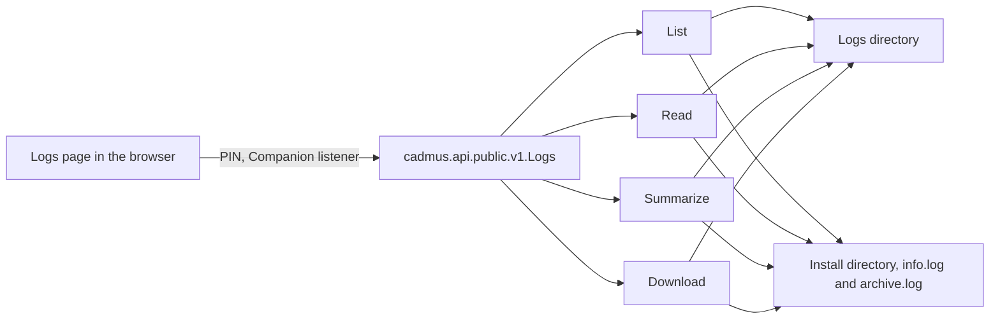

<!-- i18n:skip-start -->

# Companion logs

The Logs page in Companion reads the Cadmus logs on the device. Its purpose is
to make reporting logs easy for end users. It is a static page in the Companion
site that calls the `cadmus.api.public.v1.Logs` service on the Companion
listener. The loopback listener does not route that package, so the service is
reachable only from a Companion session and needs its PIN, like the other
Companion services (see [API](../api.md)).

Run logs live in the configured logs directory; the Launcher logs are the
launcher script's `info.log` and `archive.log` in the install directory.

The RPCs and their messages are defined in
[`proto/cadmus/api/public/v1/logs.proto`](../../../../proto/cadmus/api/public/v1/logs.proto).

<!-- i18n:skip-end -->
