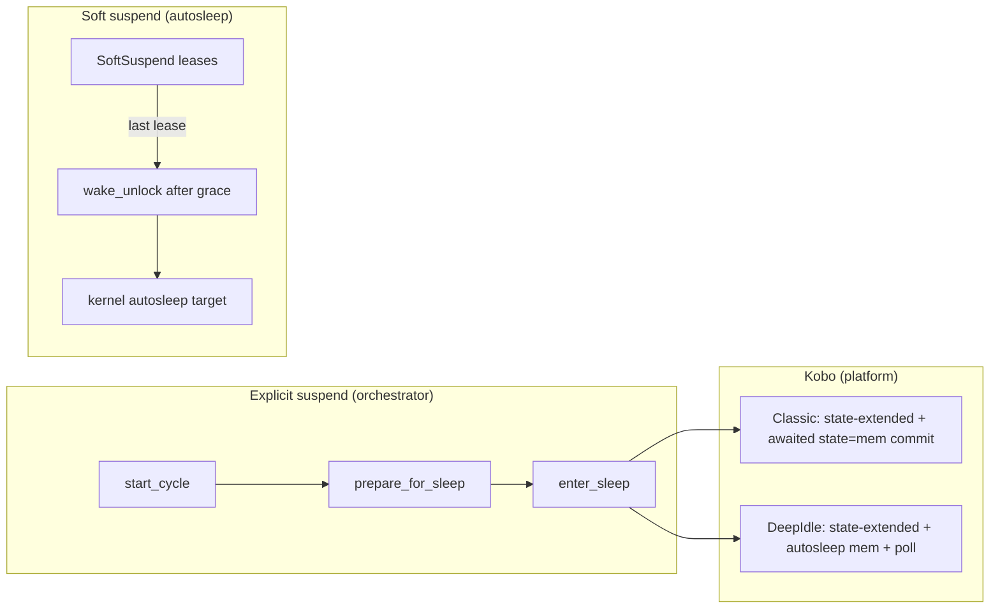

<!-- i18n:skip-start -->

# Suspend

Cadmus suspend code has three layers:

| Mechanism                                       | User sees                           | Code entry                                       | Typical trigger                                 |
| ----------------------------------------------- | ----------------------------------- | ------------------------------------------------ | ----------------------------------------------- |
| [**Explicit suspend**](orchestrator.md)         | Suspend intermission and deep sleep | `start_cycle` → prepare → `enter_sleep`          | Auto Suspend RTC, power button, sleep cover     |
| [**Soft suspend**](soft-suspend.md) (autosleep) | No explicit UI                      | Kernel autosleep after the wake lock is unlocked | Autosleep armed and no active SoftSuspend lease |
| [**Kobo platform**](kobo/suspend.md)            | Hardware hooks around sleep         | `KoboPowerManager`, `state-extended`             | Classic and DeepIdle sleep entry                |

User-facing soft suspend is in [Soft Suspend](../../../soft-suspend.md).
Research: [investigation #361](../../../investigations/kobo/issue-361-autosleep-wake-lock.md).

## How they interact



- **Auto Suspend** (minutes of idle) starts an **explicit** cycle via RTC —
  even when soft suspend is on, the orchestrator still runs prepare and enters
  Classic or DeepIdle.
- **Soft suspend** controls **opportunistic** naps while the app is interactive.
  A SoftSuspend lease keeps the wake lock held. After the last lease is
  released, the configured grace expires before the wake lock is unlocked.
- An explicit suspend cycle suppresses that shared wake lock for its kernel-sleep
  window, even when SoftSuspend holders are still alive. The leases remain
  tracked, and wake restores the lock if any holder remains.
- On Kobo, **DeepIdle** temporarily forces autosleep to `mem`, arms
  `state-extended`, releases the shared wake lock, drops its cycle lease, and
  polls for wake. **Classic** runs an owned async commit: `prepare_suspend`,
  the Full gate, the wake-lock pause, then `KoboPowerManager::suspend`, a
  `state=mem` write that blocks on the runtime's blocking pool until wake.

The **emulator** only shows the suspend intermission. It does not prepare
hardware, enter kernel sleep, or drive this orchestrator.

## Blocking sleep with the inhibitor

Async code that needs inhibitor behaviour acquires a guard through
<a href="/api/cadmus_core/device/inhibitor/struct.Inhibitor.html">`Inhibitor::acquire`</a>
and awaits it — see [Inhibitor](inhibitor.md) for API detail, LED patterns,
deferred suspend, and OTA.

| Goal                                                                   | Acquire                                                                                                | Effect                                                                                                                                                                                                                                                                                                                                                                                                                                             |
| ---------------------------------------------------------------------- | ------------------------------------------------------------------------------------------------------ | -------------------------------------------------------------------------------------------------------------------------------------------------------------------------------------------------------------------------------------------------------------------------------------------------------------------------------------------------------------------------------------------------------------------------------------------------- |
| Keep device awake for **opportunistic** autosleep between events       | <a href="/api/cadmus_core/device/inhibitor/enum.Kind.html#variant.SoftSuspend">`Kind::SoftSuspend`</a> | Holds kernel `cadmus` wake lock (Linux). **Does not** block explicit suspend. The shared lock is suppressed during the explicit kernel-sleep window and restored on wake while holders remain.                                                                                                                                                                                                                                                     |
| Defer Auto Suspend and opportunistic autosleep without blocking exits  | <a href="/api/cadmus_core/device/inhibitor/enum.Kind.html#variant.Sleep">`Kind::Sleep`</a>             | Auto path (<a href="/api/cadmus_core/device/suspend/orchestrator/fn.start_cycle_from_auto.html">`start_cycle_from_auto`</a>) defers; nested `"sleep-inhibit"` lease remains tracked through an explicit cycle. The shared `cadmus` lock is suppressed with all other holders at the kernel-sleep boundary. cadmus-test top menu. Explicit <a href="/api/cadmus_core/device/suspend/orchestrator/fn.start_cycle.html">`start_cycle`</a> still runs. |
| Block **explicit** suspend and user exits on Kobo during critical work | <a href="/api/cadmus_core/device/inhibitor/enum.Kind.html#variant.Full">`Kind::Full`</a>               | Defers <a href="/api/cadmus_core/device/suspend/orchestrator/fn.start_cycle.html">`start_cycle`</a>; aborts a started cycle if Full is acquired before the Classic gate or during a DeepIdle wait, and after wake and cleanup if the acquire waited on a held Classic gate; ignores gated user exits. Registers a nested `"full-inhibit"` lease on the SoftSuspend backend.                                                                        |

```rust
// Background work — block opportunistic nap only
let _guard = inhibitor.acquire(Kind::SoftSuspend, SoftSuspendName::Wifi).await?;

// Top menu (cadmus-test) — block opportunistic nap and Auto Suspend
let _guard = inhibitor.acquire(Kind::Sleep, "main-menu").await?;

// OTA install — block explicit suspend and user power-off/reboot
let _guard = inhibitor.acquire(Kind::Full, "ota").await?;
```

Use standard names from
<a href="/api/cadmus_core/device/inhibitor/enum.SoftSuspendName.html">`SoftSuspendName`</a>
where they exist (`input`, `wifi`, `main-loop`, …). Sleep and Full holders use
free-form names (`"main-menu"`, `"ota"`, …).

## Pages

| Page                                    | Read this for                                                                                      |
| --------------------------------------- | -------------------------------------------------------------------------------------------------- |
| [Suspend orchestrator](orchestrator.md) | `SuspendCycle` phases, Classic vs DeepIdle, RTC alarms, `start_cycle` vs `enter_sleep`             |
| [Soft suspend](soft-suspend.md)         | Autosleep sysfs, wake-lock worker, grace, `SoftSuspendKind` backends                               |
| [Inhibitor](inhibitor.md)               | `Kind::SoftSuspend` vs `Kind::Sleep` vs `Kind::Full`, deferred suspend, exit gate, status LED, OTA |
| [Kobo suspend](kobo/suspend.md)         | Lifecycle forwarding, `state-extended`, Classic vs DeepIdle on device                              |

<!-- i18n:skip-end -->
