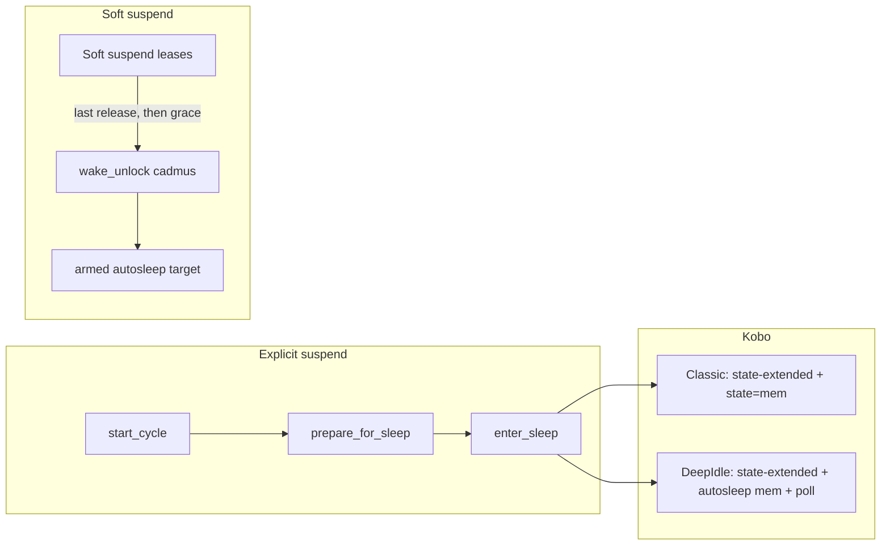

<!-- i18n:skip-start -->

# Suspend

Cadmus has three suspend layers, and only the first is a suspend in the
Glossary sense:

- **Explicit suspend** — [orchestrator](orchestrator.md): the device shows the
  intermission, tears down, then enters kernel sleep. Auto Suspend, the power
  button, and the sleep cover all start an explicit cycle.
- **Soft suspend** — [soft suspend](soft-suspend.md): opportunistic kernel
  autosleep between Cadmus events while the page stays on screen. It is governed
  by Soft suspend leases and the shared `cadmus` wake lock.
- **Kobo platform** — [Kobo suspend](kobo/suspend.md): the hardware hooks that
  turn either path into a real `mem` sleep.

User-facing behaviour is in [Soft Suspend](../../../soft-suspend.md); the
autosleep/wake-lock investigation is
[#361](../../../investigations/kobo/issue-361-autosleep-wake-lock.md).

## How they interact

The rules that are not obvious from one module:

- Auto Suspend still starts an **explicit** cycle while Soft suspend is armed.
  Soft suspend only governs the naps between events; the orchestrator still
  prepares and sleeps through Classic or DeepIdle.
- Soft suspend leases collapse onto one shared `cadmus` wake lock. The last
  release starts the autosleep grace, then unlocks.
- An explicit cycle's kernel-sleep window suppresses that shared lock even
  while Soft suspend leases are held. The leases stay tracked, and wake
  re-locks only if a holder remains.
- On Kobo, Classic writes `state=mem` in an owned commit that outlives its
  caller, while DeepIdle releases the lock and polls for wake — see
  [Kobo suspend](kobo/suspend.md).
- The emulator shows the intermission only; it never prepares hardware or
  enters kernel sleep.

## Blocking sleep with the inhibitor

Take an [`Inhibitor`](inhibitor.md) lease with
<a href="/api/cadmus_core/device/inhibitor/enum.Kind.html#variant.SoftSuspend">`Kind::SoftSuspend`</a>
for background work,
<a href="/api/cadmus_core/device/inhibitor/enum.Kind.html#variant.Sleep">`Kind::Sleep`</a>
to defer Auto Suspend, or
<a href="/api/cadmus_core/device/inhibitor/enum.Kind.html#variant.Full">`Kind::Full`</a>
for critical work that must also hold off Explicit suspend and user exits.
[Inhibitor](inhibitor.md) covers the cross-component effects and the deferred
suspend rules.

<!-- i18n:skip-end -->
