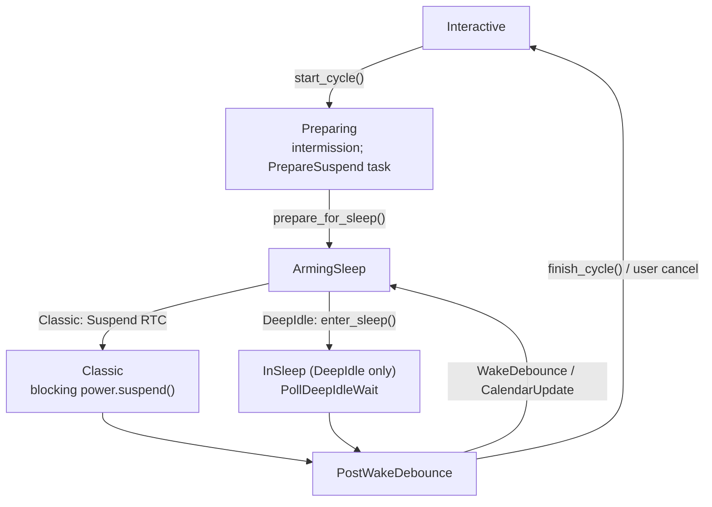

<!-- i18n:skip-start -->

# Suspend orchestrator

**Explicit** suspend: intermission UI, prepare teardown, then kernel sleep.
Shared code in
<a href="/api/cadmus_core/device/suspend/index.html">`device::suspend`</a>
(`crates/core/src/device/suspend/`).

This is separate from opportunistic [soft suspend](soft-suspend.md) and from
[Kobo platform hooks](kobo/suspend.md). To **block** starting a cycle, use
[Inhibitor `Kind::Full`](inhibitor.md). [`Kind::Sleep`](inhibitor.md) defers
only the Auto Suspend path (`start_cycle_from_auto`). SoftSuspend leases alone
do not gate `start_cycle`.

The emulator does not drive this module today.

## Workflow

Callers that mean “go to sleep” (power button, Auto Suspend RTC, sleep cover)
call
<a href="/api/cadmus_core/device/suspend/orchestrator/fn.start_cycle.html">`start_cycle`</a>,
**not**
<a href="/api/cadmus_core/device/suspend/orchestrator/fn.enter_sleep.html">`enter_sleep`</a>.

| Function            | Role                                                    |
| ------------------- | ------------------------------------------------------- |
| `start_cycle`       | Begin cycle: UI + schedule prepare                      |
| `prepare_for_sleep` | Teardown; arm Classic Suspend RTC or enter DeepIdle     |
| `enter_sleep`       | Kernel sleep (classic block or deep-idle poll)          |
| `finish_cycle`      | Tear down → interactive                                 |
| `cancel_prepare`    | Remove a stray PrepareSuspend task when no cycle exists |

<a href="/api/cadmus_core/view/enum.Event.html#variant.Suspend">`Event::Suspend`</a>
/
<a href="/api/cadmus_core/device/rtc/enum.AlarmType.html#variant.Suspend">`AlarmType::Suspend`</a>
mean **enter sleep now** (after prepare), not “start a new cycle”.

Full inhibit defers `start_cycle` as Explicit origin. Sleep defers the Auto
path only. `FullInhibitCleared` flushes Auto through `start_cycle_from_auto`
(Sleep still defers) and Explicit through `start_cycle`. Explicit Sleep cycles
pause the nested `"sleep-inhibit"` wake lock; kernel wake re-takes it if Sleep is still held — [Inhibitor § Deferred explicit suspend](inhibitor.md#deferred-explicit-suspend).

## Kind and phase

`Option<`<a href="/api/cadmus_core/device/suspend/cycle/struct.SuspendCycle.html">`SuspendCycle`</a>`>`
on
<a href="/api/cadmus_core/context/struct.Context.html#structfield.suspend">`Context::suspend`</a>.
Interactive use is `None`.

| Field   | Values                                                                                       |
| ------- | -------------------------------------------------------------------------------------------- |
| `kind`  | `Classic` or `DeepIdle` — fixed at `start_cycle` for the cycle                               |
| `phase` | `Preparing` → `ArmingSleep` → `PostWakeDebounce`; DeepIdle also uses `InSleep` while polling |

Do not re-pick Classic vs DeepIdle mid-cycle from
<a href="/api/cadmus_core/device/soft_suspend/mode/enum.AutosleepMode.html#method.is_armed">`is_armed()`</a>
alone. WakeDebounce / CalendarUpdate re-enter with the same kind.

## Sleep backends

| Kind       | Entry                                                             |
| ---------- | ----------------------------------------------------------------- |
| `Classic`  | Suspend RTC, then blocking `PowerManager::suspend` / `resume`     |
| `DeepIdle` | Force autosleep `mem`, `arm_deep_idle`, poll until wake / timeout |

Both share prepare teardown and schedule WakeDebounce after wake. AutoPowerOff
and CalendarUpdate alarms are scheduled before sleep when their settings
require them, then checked after wake. Platform details:
[Kobo suspend](kobo/suspend.md).

## Deep-idle wake detect

Production: `CLOCK_BOOTTIME` − `CLOCK_MONOTONIC` (~1 s threshold). Tests inject
<a href="/api/cadmus_core/device/suspend/wake/enum.PollResult.html">`PollResult`</a>
via `AppContext::deep_idle_poll_inject`.

On timeout, the wait re-arms while soft suspend can re-arm; otherwise
`finish_cycle`. A cycle makes at most three deep-idle attempts (two retries):
the cap counts consecutive timeouts on `SuspendCycle` and resets on a detected
wake. Past the cap the cycle falls back to `Classic` and disarms autosleep
(`Off`) for the rest of the cycle, because the kernel rejects `state=mem` while
autosleep is armed, which would turn every attempt into the same guard error;
`finish_cycle` restores the stashed mode. The cycle then stays on the classic
WakeDebounce re-sleep path, whose errno is visible, instead of polling autosleep
every 30 s.

The first timeout of a failing cycle also emits one `deep idle wait timed out;
suspend blockers` warning naming the lease holders, `/sys/power/wake_lock`,
`/sys/power/wakeup_count` (read under a short timeout), the charger/USB state,
and the IRQ delta. A refused `Classic` suspend adds the same kernel-side fields
to `Failed to suspend device`.

## Wake-source telemetry

On Linux,
<a href="/api/cadmus_core/device/suspend/orchestrator/fn.start_deep_idle_wait.html">`start_deep_idle_wait`</a>
snapshots the pre-sleep alarm state before
<a href="/api/cadmus_core/device/power/trait.PowerManager.html#method.arm_deep_idle">`arm_deep_idle`</a>
and the IRQ counters after it, just before the cycle lease drops, storing both on
<a href="/api/cadmus_core/device/suspend/cycle/struct.DeepIdleWaitState.html">`DeepIdleWaitState`</a>:

| Captured               | Source                                                    |
| ---------------------- | --------------------------------------------------------- |
| hardware wake alarm    | `Rtc::wake_alarm` → `/sys/class/rtc/rtc0/wakealarm`       |
| earliest logical alarm | `AlarmManager::next_scheduled_alarm` (future alarms only) |
| IRQ counters           | `/proc/interrupts`, sampled before the cycle lease drops  |

Each detected wake then emits one `Primary deep-idle wake` record from
<a href="/api/cadmus_core/device/suspend/orchestrator/fn.log_wake_source.html">`log_wake_source`</a>,
carrying `pre_hardware_alarm`, `pre_cadmus_alarm_type`, `pre_cadmus_alarm`,
`post_hardware_alarm`, `wake_irq`, `wake_irq_name`, `unmanaged_alarm_candidate`,
`irq_delta_status`, `irq_deltas_json` and `irq_delta_reasons_json`. Sampling
`/proc/interrupts` after wake, before the other post-wake node reads, also
supplies the existing `wake_irq_name`; each retry samples a new baseline.

What the fields mean, and what they cannot say:

- `wake_irq` is `/sys/power/pm_wakeup_irq`, read inside the wake path because the
  kernel clears it on the next suspend. `-ENODATA` means the kernel recorded no
  IRQ. Other read errors and malformed content also log `wake_irq = None`, so a
  missing value means "not reported", not that no hardware wake happened.
- `wake_irq_name` is the owning row in `/proc/interrupts`. A parent controller
  such as the PMIC (`bd71828_irq`) does not identify its own child, so compare
  per-IRQ counters before naming a source.
- `unmanaged_alarm_candidate` is true when the hardware slot and the earliest
  future logical alarm disagree. The kernel records no writer for the slot, so a
  mismatch is a candidate for an unmanaged alarm, never proof of who wrote it.
- `irq_deltas_json` is a JSON-encoded array of `{irq, name, delta}` objects. `irq`
  is a string; `name` is the post-wake action, or `null` for rows without one.
  `before_name` is present when the baseline action was present and differs from
  the post-wake action, including when the post-wake snapshot has no action. Each
  delta sums
  increases across the CPUs for one IRQ. Non-numeric summary rows (`IPI*`, `ERR`,
  `NMI`) are excluded from the comparison. Decode it with
  `.fields.irq_deltas_json | fromjson`. Parent and child rows appear independently.
  Changed counters are evidence of activity between the samples, not proof of wake
  causation; they can also include activity before sleep and after wake.
- `irq_delta_reasons_json` explains a `partial` status: a JSON array of
  `{irq, reason}` objects. Reasons are `missing_before`, `missing_after`,
  `unparseable_before`, `unparseable_after` and `counter_not_monotonic`. It is
  `[]` for `complete` and `unavailable`.
- `irq_delta_status` is `complete` for a successful comparison, including no changes,
  `partial` when unusable rows, rows added, removed, or duplicated, or
  counter decreases/overflows make the coverage incomplete, or `unavailable` when a
  snapshot, valid CPU header, or numeric row data cannot support a comparison, including
  CPU columns that differ between samples. Only positive deltas are emitted; missing or
  incompatible data does not become a zero.
- `next_scheduled_alarm` ignores past-due alarms, matching what
  `update_hardware_alarm_at` programs into the slot.

Non-Linux targets still record the earliest logical alarm, but the hardware slot
reads `Unavailable` and nothing is emitted.

## Phase-aware Suspend

| Situation                                                  | Action                          |
| ---------------------------------------------------------- | ------------------------------- |
| `Suspend` during `InSleep` / `PostWakeDebounce`            | Ignore                          |
| Interactive + soft armed + classic `Suspend` without cycle | Refuse; reschedule Auto Suspend |

<!-- i18n:skip-end -->
