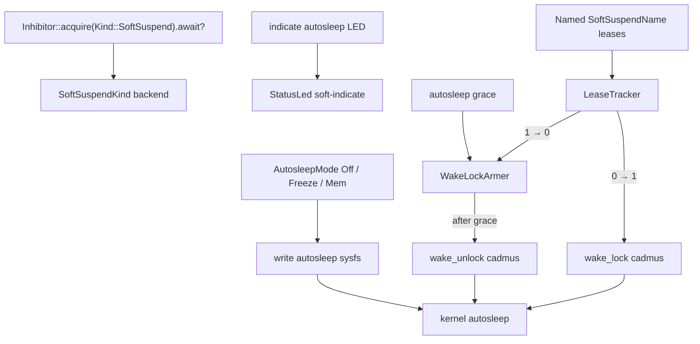

<!-- i18n:skip-start -->

# Soft suspend

Opt-in **opportunistic** sleep: the kernel autosleep workqueue naps between
Cadmus events when no Soft suspend lease holds the userspace wake lock. This is
**not** the Auto Suspend path; that is [explicit suspend](orchestrator.md).

User-facing behaviour: [Soft Suspend](../../../soft-suspend.md).

## Architecture

Named leases only adjust Cadmus's refcount; the kernel sees one shared
`cadmus` lock. Registration alone only cancels a pending unlock —
`confirm_leases` performs the lock write. The last release starts the autosleep
grace, and a lease acquired during grace cancels the pending unlock.

## Backends

Linux is live when the sysfs probe succeeds; NoOp (leases tracked in process,
no sysfs or unlock worker) covers the emulator and probes that fail. Kobo
builds the live backend only when all four sysfs nodes are usable. Power
settings hide Soft suspend rows when
<a href="/api/cadmus_core/device/soft_suspend/trait.SoftSuspendBackend.html#method.is_supported">`is_supported`</a>
is false.

Implementation: `crates/core/src/device/linux/soft_suspend/`.

## Settings

Autosleep mode, grace, and LED indication are configured through
<a href="/api/cadmus_core/device/soft_suspend/trait.SoftSuspendBackend.html">`SoftSuspendBackend`</a>
(implemented by `Inhibitor`); lease acquisition is not on that trait.

On Linux the live kind:

- Writes `/sys/power/autosleep` (`off` / `freeze` / `mem`). The cached mode
  changes only after a successful write; a failed write returns an error and
  keeps the previous mode, and the settings editor reverts the displayed value
  so the screen never disagrees with the device.
- Maps lease tracker 0→1 to `wake_lock cadmus` and 1→0 to a deferred
  `wake_unlock` after **autosleep grace**, so a brief gap between leases does
  not let the kernel nap.
- Suppresses the shared lock for an Explicit suspend sleep window without
  dropping any lease: `wake_unlock` is written immediately, bypassing grace,
  holder accounting continues, and resume re-locks only when holders remain.
  The window is a `Suppression` epoch; only the live window's ticket is
  current, so a stale pause from an earlier leg can never match. Suppression is
  refused while a Full lease is live; acquiring Full during the window re-locks
  `cadmus` at once.
- Optionally drives `soft-indicate` on the shared
  <a href="/api/cadmus_core/device/leds/struct.StatusLed.html">`StatusLed`</a>
  arbiter ([priorities in Inhibitor](inhibitor.md#status-led-arbiter)).

Wake-lock writes share one reconcile loop on blocking-pool control workers;
[Inhibitor § Wake-lock write failures](inhibitor.md#wake-lock-write-failures)
covers its single-writer and retry semantics.

Kobo **DeepIdle** Explicit suspend also forces `mem` autosleep during the
cycle — see [Kobo suspend](kobo/suspend.md).

Upstream:
[sysfs-power ABI](https://www.kernel.org/doc/Documentation/ABI/testing/sysfs-power).

<!-- i18n:skip-end -->
