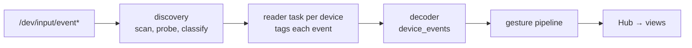

<!-- i18n:skip-start -->

# Input Pipeline

The input pipeline turns Linux evdev events into the semantic events views
handle. It lives in
<a href="/api/cadmus_core/input/index.html">`cadmus_core::input`</a>.

## Module layout

| Module                                                                        | Holds                                                                                               |
| ----------------------------------------------------------------------------- | --------------------------------------------------------------------------------------------------- |
| <a href="/api/cadmus_core/input/codes/index.html">`codes`</a>                 | Evdev event types, codes and values; the Kobo gsensor values; the synthetic codes Cadmus injects.   |
| <a href="/api/cadmus_core/input/event/index.html">`event`</a>                 | `InputEvent`, `SourceId`, `EventSource`, `TaggedInputEvent`, and the `DeviceEvent` a view receives. |
| <a href="/api/cadmus_core/input/profile/index.html">`profile`</a>             | `DeviceProfile` / `KeyAction` and the per-profile scancode tables.                                  |
| <a href="/api/cadmus_core/input/keyboard/index.html">`keyboard`</a>           | `Modifier`, `Modifiers`, `KeyEvent` — Wayland-shaped key and modifier state.                        |
| <a href="/api/cadmus_core/input/touch/index.html">`touch`</a>                 | Touch protocols, the per-source `TouchPipeline`, and the axis/rotation mapping helpers.             |
| <a href="/api/cadmus_core/input/reader/index.html">`reader`</a>               | `raw_events` and the per-device `AsyncFd` read loop, plus its silence watch.                        |
| <a href="/api/cadmus_core/input/usb/index.html">`usb`</a>                     | The `/tmp/nickel-hardware-status` FIFO reader that reports USB power events.                        |
| <a href="/api/cadmus_core/input/discovery/index.html">`discovery`</a>         | Scan, probe, classify, the inotify watch, and the loop that owns readers.                           |
| <a href="/api/cadmus_core/input/decoder/index.html">`decoder`</a>             | `device_events`, the state machine that turns tagged evdev events into `DeviceEvent`s.              |

<a href="/api/cadmus_core/input/struct.TaggedInputEvent.html">`TaggedInputEvent`</a>
carries the device profile and the
<a href="/api/cadmus_core/input/event/enum.EventSource.html">`EventSource`</a>
alongside the raw event, because several devices share one channel and
per-device state (touch reports, held modifiers) must not leak between them.
Injected events use `EventSource::Synthetic` so they can never be mistaken for a
device.

## Discovery and hotplug

Startup scans `/dev/input/event*`, opens each node once, and classifies it from
its kernel features (`EVIOCGID`, `EVIOCGNAME`, `EVIOCGBIT`): Kobo Remote by name,
built-in hardware by name or bus type, digitizers by their position axes, and
everything else as a generic keyboard. Devices sharing an identity are opened
once; the extra nodes are blacklisted, and blacklist entries are dropped when the
node disappears so a recycled `eventN` is probed again.

After startup the loop reacts to changes:

- **inotify watch** on `/dev/input` (`IN_CREATE`, `IN_DELETE`, `IN_MOVED_*`,
  `IN_ATTRIB`). A reported change is held for `HOTPLUG_DEBOUNCE` (100 ms) so
  udev has applied ownership and permissions before the node is probed.
- **Reader retry** (`READER_RETRY_DELAY`, 5 s) after a reader exits or a scan
  fails. A reader that dies while its node stays put, or a node that cannot be
  opened yet, produces no further directory event; without this the device would
  stay closed until the fallback.
- **Fallback rescan** (`FALLBACK_RESCAN_INTERVAL`, 60 s) covers `IN_Q_OVERFLOW`
  and any missed event.
- **Polling fallback**: if the watch cannot be created, the loop rescans every
  `SCAN_INTERVAL` (5 s).

Readers are owned by a `JoinSet` so the loop can observe exits and release the
device's identity, which is what lets a replug be re-detected.

<!-- i18n:skip-end -->
